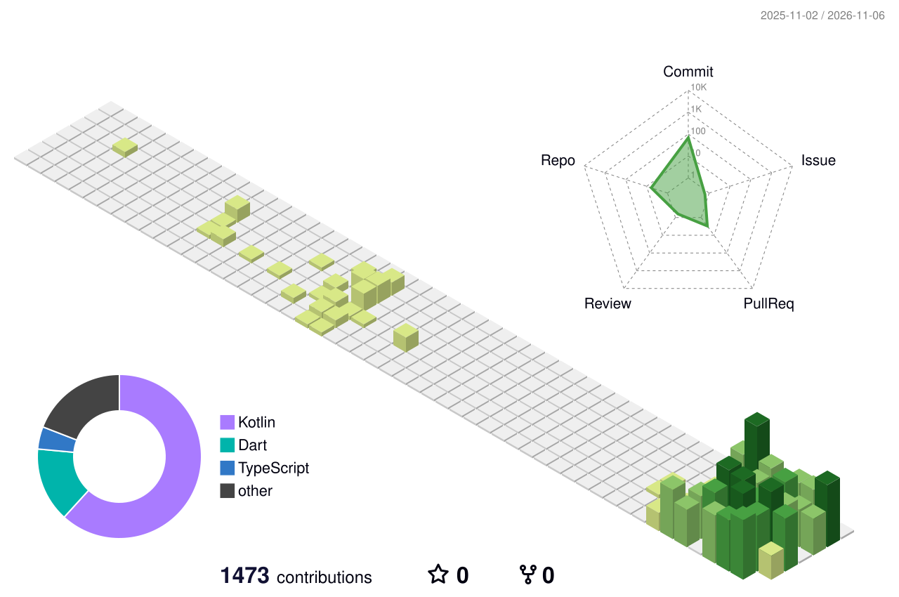

  

  

  
  
  
  
  

 

## 👋 About me

I'm a full-stack developer from the Philippines, working remotely worldwide. I build mobile apps, websites and the automation behind them, and I help sites get found by search engines and AI answer engines.

- 📱 **Mobile:** cross-platform apps with Flutter, plus native Android with Kotlin
- 🔎 **AEO / GEO / SEO:** making sites visible in Google, ChatGPT, Perplexity and AI Overviews
- ⚙️ **Automation & QA:** Python and scripts that take repetitive work off people's plates
- 🤝 **Open to:** freelance projects and collaborations

## 🧭 What I do

| Area | Focus |
| --- | --- |
| 📱 Mobile development | Flutter and Kotlin apps with camera, GPS, local storage and offline sync |
| 🔎 AEO · GEO · SEO | Structured data (JSON-LD), `llms.txt`, AI-visibility tracking, Search Console and GA4 |
| 🌐 Web | WordPress builds, custom PHP, responsive front ends |
| ⚙️ Automation & QA | Python tools, workflow automation, testing and process improvement |
| 👁️ Computer vision | YOLO object detection, dataset labeling, model tuning |
| 🤖 AI & DevOps | AI-assisted workflows, API integrations, GitHub Actions, Docker |

## 🛠️ Tech stack

  

## 📊 GitHub Statistics

  
  

## 🔥 Contribution Streak

  

## 📈 Contributions

  <picture>
    <source media="(prefers-color-scheme: dark)" srcset="https://raw.githubusercontent.com/ean28/ean28/main/profile-3d-contrib/profile-night-rainbow.svg" />
    
  </picture>

  

